<!-- Cards are drawn by scripts/render_cards.py and redrawn every day by .github/workflows/readme-cards.yml -->

  

  

  
  
  
  

  

<b>📂 Featured projects</b>

 

| Project | What it is | Stack |
|---|---|---|
| 💡 [LightsOut](https://github.com/MarioCarcalete/Programaci-n_multiplataforma_Kotlin_y_dem-s/tree/main/LightsOut) | Android logic game with 3x3 to 5x5 boards, timer, move counter, random solvable games and haptics | Kotlin · Android |
| 🧪 [TelemetrySystem](https://github.com/MarioCarcalete/Ampliacion-EntornosIDE-Testing) | SOLID refactor of untestable legacy code, covered with unit tests and mocks running on GitHub Actions | Java · JUnit 5 · Mockito |
| 🗄️ [Data access toolkit](https://github.com/MarioCarcalete/Ejercicios-Java-PP/tree/main/Acceso-Datos/Examen_AccesoDatos) | Read/write the same model in TXT, binary, XML, JSON and MySQL, with 18 migrations between formats | Java · JDBC · Gson · Docker |
| 🧵 [Processes & threads](https://github.com/MarioCarcalete/PSP_Dam) | Multiprocess programs with `ProcessBuilder` and concurrency exercises with synchronized threads | Java |
| 🌐 [Web forms](https://github.com/MarioCarcalete/Lenguage-De-Marcas) | Forms built with HTML and CSS, validated in JavaScript | HTML · CSS · JS |

<b>🚀 More about me</b>

 

- 🎓 2nd year of **DAM** (Desarrollo de Aplicaciones Multiplataforma) in Madrid
- 📱 This year: **Kotlin** for Android, plus data access and service/process programming in **Java**
- 🗄️ Comfortable with **SQL** (MySQL) and **NoSQL** (MongoDB)
- 🐍 Also code in **Python**, and I'm getting into backend with **Java & Spring Boot**
- 🤖 Building a personal AI assistant that orchestrates other AI models to get things done
- 🔐 Growing interest in **cybersecurity**

 

<picture>
  <source media="(prefers-color-scheme: dark)" srcset="https://raw.githubusercontent.com/MarioCarcalete/MarioCarcalete/output/pacman-contribution-graph-dark.svg">
  <source media="(prefers-color-scheme: light)" srcset="https://raw.githubusercontent.com/MarioCarcalete/MarioCarcalete/output/pacman-contribution-graph.svg">
  
</picture>
