  

  
  
  

## 👋 Sobre mí

Estudio **2º de Desarrollo de Aplicaciones Multiplataforma** en el IES Francisco de Goya (Madrid) y busco **prácticas (FCT) en desarrollo de software**. Programo en **Java, Kotlin y Python**, trabajo con bases de datos **MySQL, SQLite y MongoDB**, y ya he llevado la **inteligencia artificial y la automatización** a procesos reales.

## 💼 Experiencia

**Automatización de procesos con IA** · ONGAWA (ONG) · prácticas FCT 2025–2026

- Flujos en **n8n** que procesan facturas y justificantes en PDF, documentos escaneados e imágenes.
- Modelos de IA (**Claude, Mistral AI**) como OCR para extraer los datos de cada documento.
- Parseo y limpieza de datos con **JavaScript y JSON**.
- Informes en **Excel** generados por API, de la extracción a la exportación, sin pasos a mano.

## 🛠️ Tecnologías

  

  
  
  

## 📂 Proyectos del ciclo

| Proyecto | Qué es | Tecnología |
|---|---|---|
| 💡 [LightsOut](https://github.com/MarioCarcalete/Programaci-n_multiplataforma_Kotlin_y_dem-s/tree/main/LightsOut) | Juego de lógica para Android con tableros de 3x3 a 5x5, cronómetro, contador de movimientos y partidas siempre resolubles | Kotlin · Android |
| 🧪 [TelemetrySystem](https://github.com/MarioCarcalete/Ampliacion-EntornosIDE-Testing) | Código heredado refactorizado con SOLID y cubierto con tests y mocks que se ejecutan en GitHub Actions | Java · JUnit 5 · Mockito |
| 🗄️ [Acceso a datos](https://github.com/MarioCarcalete/Ejercicios-Java-PP/tree/main/Acceso-Datos/Examen_AccesoDatos) | El mismo modelo en TXT, binario, XML, JSON y MySQL, con 18 migraciones entre formatos | Java · JDBC · Gson · Docker |
| 🧵 [Procesos e hilos](https://github.com/MarioCarcalete/PSP_Dam) | Programas multiproceso con `ProcessBuilder` y concurrencia con hilos sincronizados | Java |
| 🌐 [Formularios web](https://github.com/MarioCarcalete/Lenguage-De-Marcas) | Formularios con HTML y CSS validados con JavaScript | HTML · CSS · JS |

 

<picture>
  <source media="(prefers-color-scheme: dark)" srcset="https://raw.githubusercontent.com/MarioCarcalete/MarioCarcalete/output/pacman-contribution-graph-dark.svg">
  <source media="(prefers-color-scheme: light)" srcset="https://raw.githubusercontent.com/MarioCarcalete/MarioCarcalete/output/pacman-contribution-graph.svg">
  
</picture>
